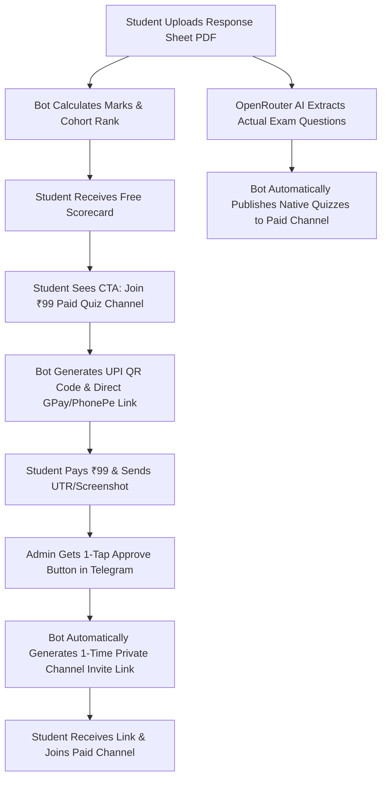

# ExamRankers Telegram Ecosystem: Bot + ₹99 Paid Quiz Channel

An end-to-end automated system consisting of:
1. **Free Telegram Bot**: Aspirants upload response-sheet PDFs to calculate marks, negative scoring, and predicted cohort rank for free.
2. **AI Question Extraction & Auto-Quizzes**: When a response sheet is processed, the bot uses **OpenRouter AI** to extract questions, format them as MCQs, and **automatically posts them as interactive Telegram Quizzes** (`send_poll(type='quiz')`) into your **Paid Channel**.
3. **₹99 Paid Telegram Quiz Channel**: Users pay ₹99 via UPI to join. The bot generates unique, single-use Telegram private invite links upon approval so members cannot share the link with unauthorized users.

---

## 🚀 Setup & Launch Guide

### 1. Configure `.env`
Open `exam_rank_predictor_bot/.env`:

```env
# 1. Telegram Bot Token & Admin ID
TELEGRAM_BOT_TOKEN=your_bot_token_here
ADMIN_TELEGRAM_IDS=your_numeric_telegram_id

# 2. OpenRouter Paid API Key (for AI Quiz Generation)
OPENROUTER_API_KEY=your_openrouter_key_here
OPENROUTER_MODEL=google/gemini-2.0-flash-001

# 3. Paid Telegram Channel (₹99 Access)
PAID_CHANNEL_ID=@your_paid_quiz_channel
CHANNEL_FEE_INR=99

# 4. Your UPI Details (GPay / PhonePe / Paytm)
UPI_ID=yourname@upi
UPI_NAME=ExamRankers
```

> [!IMPORTANT]
> **Channel Admin Permission**: Add your bot as an **Administrator** in your Paid Telegram Channel (`PAID_CHANNEL_ID`) with permissions to:
> - Post Messages
> - Manage Chat / Invite Users via Links

---

## ⚡ How the Automated Flow Works



---

## 👑 Admin Commands

- `/stats` — View total bot users, response sheets analyzed, approved ₹99 members, and total revenue.
- `/paid_users` — List all ₹99 channel subscription requests and invite links.
- `/post_quizzes <ID>` — Manually parse and push quizzes from any previous response sheet ID into the channel.
- `/set_ad Text | Button | URL` — Change the sponsored ad banner shown on scorecards.
- `/broadcast <Message>` — Send announcements to all registered bot users.
- `/admin_files` — List stored candidate response sheets.
- `/getfile <ID>` — Download stored candidate response sheet.

---

## 🏃‍♂️ How to Run

- **1-Click Launch (Windows)**: Double-click `run.bat` in the root folder.
- **Terminal**: `python run.py`
